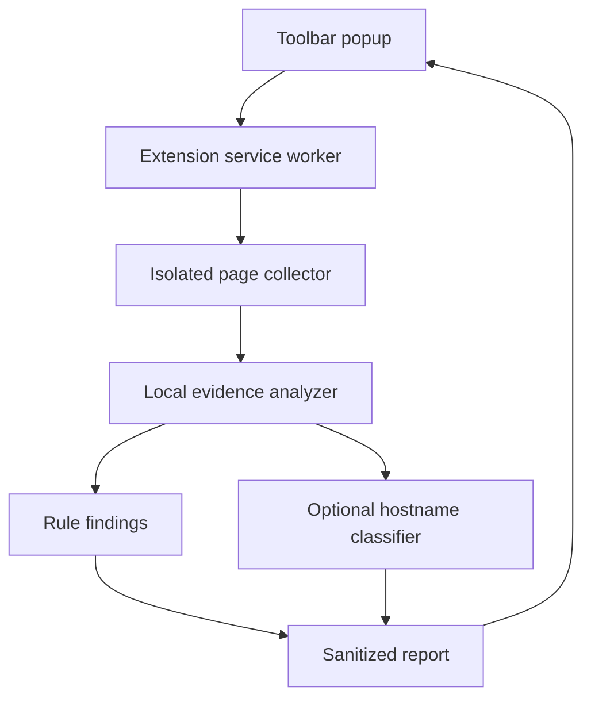

# SiteLens

A Chrome extension that explains suspicious website evidence: brand/domain mismatches, lookalike hostnames, misleading links, and declared password-form destinations. All scanning and optional model inference run locally.

**Start with [START_HERE.md](START_HERE.md).** `dist/` is ready to load as an unpacked extension. No build or API key is required to use it.

## What works

- On-click scanning with Manifest V3 `activeTab` and `scripting` permissions.
- A small brand registry with a form editor for adding and removing custom brands.
- Public Suffix List domain parsing with private hosting boundaries via `tldts`.
- Visible password-field detection; declared form targets include `<base>` resolution and `formaction` overrides.
- Context for recognized identity providers, without treating external authentication as proof of phishing or safety.
- A locally bundled experimental hostname classifier with reproducible training, domain-disjoint evaluation, and documented limitations.
- A readable popup, settings, sanitized JSON report export, explicit errors, and coverage limitations.
- Eight controlled fictional-brand demo pages with submission disabled by both JavaScript and CSP.

No background browsing surveillance, external requests, remote models, analytics, accounts, API keys, or database.

## Run and develop

Node.js 20.19+, npm. Node 22 LTS or newer recommended.

```bash
npm ci
npm run typecheck
npm test
npm run evaluate
npm run demo
```

Open `http://localhost:4173`. Load `dist/` at `chrome://extensions` using Developer mode → Load unpacked.
After source changes, run `npm run build`, click Reload on the extension card, and reopen the popup.

The built extension targets Chrome 120+ and uses no remote executable code.
The Python environment is only needed to retrain the model, not to scan pages.

## Architecture



`src/collector.ts` is self-contained so Chrome can serialize it for `scripting.executeScript`.
It reads page structure and selected identity text, never field values. The worker receives the current URL in memory to analyze its hostname; paths and query strings are excluded from the returned report.
The popup only receives a sanitized report. DOM-derived strings are rendered with `textContent`, not HTML interpolation.
Settings are validated and stored in `chrome.storage.local`; scan reports are not stored.
Messages are accepted only from this extension's own pages.

## Verdict policy

Rules add heuristic evidence weights. These are **not probabilities**. A total >=25 requests review; >=65 produces strong warnings. The source contains the individual weights.
For example, a brand/domain mismatch (45) plus a lookalike hostname (30) creates strong warning signs. An HTTP declared password destination (70) does so alone.
Internationalized hostnames alone are informational. Brand mentions without password fields do not trigger the brand-impersonation rule.

The default is rules-only. The optional hostname model can add review-level evidence; it never suppresses rule findings or creates the strongest verdict alone.
The classifier is skipped on local development origins and configured brand domains to avoid redundant hostname-based false alarms. All evidence rules continue to run there, and recognition does not establish safety.

## Machine learning

Read [ml/MODEL_CARD.md](ml/MODEL_CARD.md) before interpreting results.

The classifier uses 12 hostname features with StandardScaler and logistic regression.
Protocol, path, query, port, and a leading `www` label are excluded to reduce obvious historical dataset shortcuts.
Training and inference share the same JS extractor. Only coefficients, scaling values, metrics, and small numeric parity vectors are shipped; source dataset rows are not.

The UCI PhiUSIIL dataset is from 2024. A grouped holdout measures performance on unseen registrable domains in that dataset. It does not demonstrate current browsing protection, performance on new phishing campaigns, or improvement of the full hybrid extension.

```bash
python3 -m venv .venv
source .venv/bin/activate
python3 -m pip install -r ml/requirements.txt
python3 ml/prepare_data.py
npm run build
node ml/extract_features.mjs
python3 ml/train.py
npm run build
npm test
npm run evaluate
```

Download and package installation require internet. Runtime scanning does not.

## Test evidence

`npm test` exercises domain boundaries, legitimate authentication, lookalikes, model parity, data redaction, collection limits, action overrides, and the popup/worker/collector/export flow in jsdom with simulated Chrome APIs.
jsdom has no rendering engine; those tests cannot verify Chrome permission prompts, actual toolbar grants, or pixel layout. See [docs/TESTING.md](docs/TESTING.md) and [reports/VERIFICATION.md](reports/VERIFICATION.md).

Optional real-Chromium tests:

```bash
npx playwright install chromium
npm run build
npm run test:browser
```

The test runner grants loopback-only host permissions to a temporary extension copy. The production manifest retains on-click-only access. Perform the documented manual toolbar smoke test as well.
Set `SITELENS_CHROMIUM_PATH` to use a Chrome for Testing / Chromium executable already on your machine.

## Scope and limits

This release inspects a snapshot of the main document. It does not observe network traffic, redirects, JavaScript-generated submissions, embedded frames, domain ownership, reputation feeds, certificate details, or visual impersonation. Those omissions are visible in every report.
The brand registry is deliberately small and can be incomplete. HTML can be misleading, and valid services can resemble suspicious patterns. A clean verdict means only that the implemented checks found no strong signs in the available evidence.
More details: [docs/SECURITY.md](docs/SECURITY.md).

## Package

```bash
npm run package
```

Writes `SiteLens.zip` beside the project folder, including source, prebuilt extension, tests, model, and documentation. It excludes dependencies, raw training data, profiles, and temporary QA artifacts.

## Attribution

Project source: MIT. Domain parsing: `tldts` / `tldts-core`, MIT; licenses are copied into `dist/`.
Training dataset: Arvind Prasad and Shalini Chandra, *PhiUSIIL Phishing URL (Website)*, UCI Machine Learning Repository, 2024, CC BY 4.0. DOI: https://doi.org/10.1016/j.cose.2023.103545.
Dataset-derived model artifacts retain that attribution; see `THIRD_PARTY_NOTICES.md`.
